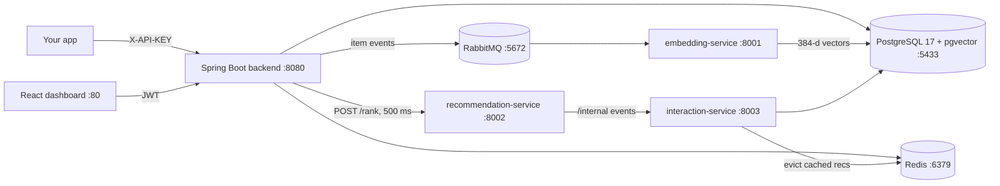

# Susume

**A multi-tenant recommendation engine you call over HTTP.** Send it what your users do, ask it what to show them next.


Susume (勧め, Japanese for "recommendation") gives e-commerce, media and SaaS products "recommended for you" and "people also viewed" rows without building an ML team. Your app sends catalog items and user events (view, click, like, share, cart, purchase). Susume returns a ranked, personalized list for each user.

- **Multi-tenant.** Each tenant's items, events, caches and API keys are kept separate. The tenant comes from the API key, never from the request body.
- **Two-stage ranking.** Ten candidate strategies build a shortlist. A LightGBM LambdaMART model then re-ranks it.
- **Fails safe.** The ML step has a 500 ms budget. If it's slow, down or still warming up, the backend serves the strategy order instead of an error.
- **Training and serving use the same feature code.** One Python module computes model inputs for both, and a test checks that the feature rows are bit-identical.
- **Admin dashboard.** Manage API keys, enable and weight strategies, invite teammates and watch usage, all without code.

---

## Architecture



| Service | Stack | Port | Responsibility |
|---|---|---|---|
| [`backend`](backend) | Java 17, Spring Boot 3.2, Flyway | 8080 | Auth (JWT + API keys), tenants, catalog, events, the 10 candidate strategies, fallback, impression logging. Owns the database schema. |
| [`recommendation-service`](recommendation-service) | Python, FastAPI, LightGBM | 8002 | Builds features from raw events and re-ranks candidates with `susume-ranker v2`. Also holds the offline training pipeline. |
| [`interaction-service`](interaction-service) | Python, FastAPI, async SQLAlchemy | 8003 | Records and serves interaction events, with internal endpoints the ranker reads. [README](interaction-service/README.md) |
| [`embedding-service`](embedding-service) | Python, FastAPI, sentence-transformers | 8001 | Consumes item events from RabbitMQ and stores `all-MiniLM-L6-v2` embeddings in pgvector. |
| [`frontend`](frontend) | React 19, TypeScript, Vite, Tailwind v4 | 80 | Admin dashboard. |
| Postgres / Redis / RabbitMQ | pgvector:pg17, Redis 7, RabbitMQ 3 | 5433 / 6379 / 5672, 15672 | Storage, recommendation cache, item event queue. |

### How a recommendation is served

1. Your app calls `GET /api/v1/recommendations?externalUserId=...`. Cached results are returned straight from Redis.
2. On a cache miss, the backend runs the enabled strategies ([`CandidateAggregator`](backend/src/main/java/com/susume/recommendation/service/CandidateAggregator.java)) to propose candidate item IDs.
3. The backend sends only the IDs to `recommendation-service`. The ML service fetches the user's recent events and a per-tenant snapshot (refreshed hourly) from `interaction-service`, computes 35 features, and scores the candidates.
4. The backend drops inactive items, cuts the list to `limit`, logs impressions, and responds.

The `strategy` field in the response tells you which path served it:

| `strategy` | Meaning |
|---|---|
| `personalized_ml_reranked` | Ordered by the ML model |
| `personalized_cold_start_popularity` | User has no history, so items are ordered by tenant popularity |
| `personalized` | ML unavailable (timeout, snapshot still building, no internal token). Strategy order, `modelVersion: spring-baseline` |
| `trending` | Returned by `/trending` |

### Candidate strategies

Collaborative filtering, content-based, frequently bought together, hybrid, personalized, popularity, random discovery, rule-based, similar items (pgvector cosine search), and trending (time-decayed). Each one is in [`backend/.../strategy`](backend/src/main/java/com/susume/recommendation/strategy). Tenants turn them on or off and set their weights from the dashboard.

---

## The ranking model

`susume-ranker v2` is a LightGBM `LGBMRanker` (lambdarank) trained on the public [RetailRocket](https://www.kaggle.com/datasets/retailrocket/ecommerce-dataset) e-commerce dataset. It uses graded labels (view 1, cart 2, purchase 3) and a time-based train/val/test split. It takes 35 features: 10 strategy scores, plus user, item, user-item and context signals.

Offline test results, per query, k = 10 ([full report](recommendation-service/models/susume_ranker_v2_report.md)):

| Model | NDCG@10 | Recall@10 | HitRate@10 |
|---|---|---|---|
| Popularity | 0.004 | 0.008 | 0.015 |
| Collaborative filtering (item-item) | 0.136 | 0.207 | 0.273 |
| Hand-weighted blend (fallback heuristic) | 0.143 | 0.224 | 0.304 |
| Personalized (recency-weighted history) | 0.170 | 0.193 | 0.267 |
| Logistic regression | 0.222 | 0.281 | 0.368 |
| **LightGBM LambdaMART** | **0.260** | **0.325** | **0.417** |

Candidate recall is 0.366. This is the share of engaged items that the generators surface at all, so no re-ranker can score above it.

**Training/serving parity.** All feature code lives in [`recommendation-service/app/features/`](recommendation-service/app/features). Both `training/build_dataset.py` and the `/rank` endpoint call it, and the backend sends no feature values. [`tests/test_serving_parity.py`](recommendation-service/tests/test_serving_parity.py) runs random event logs through both paths and checks that the feature rows are identical.

**Caveat:** the model was trained on RetailRocket, not on your tenants' data. Impressions are logged for every response, so you can compare `personalized_ml_reranked` against the strategy order on live traffic.

More detail:
- [docs/ml-ranking-serving.md](docs/ml-ranking-serving.md): request flow, fallbacks, configuration
- [docs/recommendation-model-explained.md](docs/recommendation-model-explained.md): what the model does, in plain terms
- [docs/rerank-models.md](docs/rerank-models.md): re-ranking approaches considered

---

## Quick start

**Prerequisites:** Docker Desktop and OpenSSL. You need Java 17 + Maven and Python 3.11+ only for local development.

### 1. Configure

```bash
cp .env.example .env
```

Set `INTERNAL_API_TOKEN` in `.env`. Without it, ML ranking is off and everything falls back to the strategy order.

```bash
openssl rand -hex 32
```

### 2. Create the JWT signing keys

The backend signs dashboard JWTs with an RSA key pair (PKCS#8 private key, X.509 public key):

```bash
mkdir keys
openssl genpkey -algorithm RSA -pkeyopt rsa_keygen_bits:2048 -out keys/private.pem
openssl rsa -in keys/private.pem -pubout -out keys/public.pem
```

Point `KEYS_DIR` in `.env` at that folder (for example `KEYS_DIR=./keys`).

### 3. Run

```bash
docker compose up -d --build
```

The first start downloads the embedding model, which can take a few minutes.

| What | URL |
|---|---|
| Dashboard | http://localhost |
| Backend API | http://localhost:8080 (`/actuator/health`) |
| Ranker | http://localhost:8002/health |
| Interaction service | http://localhost:8003/docs |
| Embedding service | http://localhost:8001/health |
| RabbitMQ console | http://localhost:15672 (`guest` / `guest`) |
| PostgreSQL | `localhost:5433` |

### 4. Try it

Register in the dashboard, create an API key, then:

```bash
API=http://localhost:8080/api/v1
KEY=<your api key>

# Add a catalog item (it gets embedded in the background)
curl -X POST $API/items -H "X-API-KEY: $KEY" -H "Content-Type: application/json" \
  -d '{"externalItemId": "sku-123", "metadata": {"title": "Trail running shoes", "category": "footwear"}}'

# Record what a user did
curl -X POST $API/interactions -H "X-API-KEY: $KEY" -H "Content-Type: application/json" \
  -d '{"externalUserId": "6f1c...-uuid", "externalItemId": "sku-123", "interactionType": "VIEW"}'

# Ask what to show them next
curl "$API/recommendations?externalUserId=6f1c...-uuid&limit=10" -H "X-API-KEY: $KEY"
```

---

## API overview

API-key routes use the `X-API-KEY` header. Dashboard routes use a JWT from `/api/v1/auth/login`. The dashboard also includes an interactive API reference.

| Method | Path | Auth | Purpose |
|---|---|---|---|
| `GET` | `/api/v1/recommendations?externalUserId=&limit=` | API key | Personalized recommendations |
| `GET` | `/api/v1/recommendations/trending?limit=&days=` | API key | Trending items |
| `POST` / `PUT` / `DELETE` / `GET` | `/api/v1/items[/{externalItemId}]` | API key | Manage the catalog |
| `POST` | `/api/v1/interactions` | API key | Record `VIEW`, `CLICK`, `LIKE`, `SHARE`, `CART` or `PURCHASE` |
| `GET` | `/api/v1/interactions/history?externalUserId=` | API key | A user's events, newest first |
| `GET` | `/api/v1/interactions/export` | API key | Paginated bulk export for training |
| `*` | `/api/v1/auth/*` | none / JWT | Register, login, email verification, password reset |
| `*` | `/api/v1/api-keys` | JWT | Create, list and revoke API keys |
| `*` | `/api/v1/admin/recommendations/*` | JWT | Strategy toggles, weights, preview |
| `GET` | `/api/v1/dashboard/stats` | JWT | Usage stats |

The interaction endpoints are also served by `interaction-service` on port 8003, with the same request and error shapes.

---

## Development

### Backend

```bash
cd backend
mvn test
```

Schema changes go in Flyway migrations under `backend/src/main/resources/db/migration`. The Python services map tables but never run DDL.

### Recommendation service

```bash
cd recommendation-service
pip install -r requirements.txt
python -m pytest
```

**Retraining:** download `events.csv` from the [RetailRocket dataset](https://www.kaggle.com/datasets/retailrocket/ecommerce-dataset) into `recommendation-service/data/retailrocket/`, then run:

```bash
python -m training.train
```

This builds the dataset (cached between runs), trains the baselines, logistic regression and LightGBM, and writes `models/susume_ranker_v2.joblib` along with its `_meta.json` and `_report.md`. Serving reads the query settings from `_meta.json`, so a retrained model is picked up as-is.

### Interaction service

```bash
cd interaction-service
pip install -r requirements-dev.txt
pytest        # in-memory SQLite + fake cache, no Docker needed
```

### Frontend

```bash
cd frontend
npm install
npm run dev
```

---

## Repository layout

```text
backend/                  Spring Boot API: auth, tenants, catalog, strategies, fallback
  src/main/java/com/susume/recommendation/
    strategy/             the 10 candidate strategies
    service/              CandidateAggregator, RecommendationFacade, ImpressionLogger, caching
    client/               RecommendationRankingClient (500 ms budget to the ranker)
  src/main/resources/db/migration/   Flyway migrations V1–V9
recommendation-service/   ML ranker
  app/features/           shared feature code (events, snapshot, query)
  app/serving/            feature store + interaction-service client
  app/ranking/            model scoring
  training/               dataset builder, training, evaluation
  models/                 susume_ranker_v2 artifact, metadata, report
interaction-service/      event ingestion + internal event API
embedding-service/        RabbitMQ consumer → pgvector embeddings
frontend/                 React admin dashboard
design/                   UI mockups
docs/                     ML design notes
docker-compose.yml
.env.example
```
