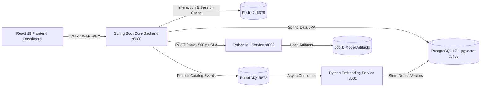

# 🍣 Susume

**Recommendations that actually know your users — dropped into your app in an afternoon.**

[](https://www.oracle.com/java/)
[](https://spring.io/projects/spring-boot)
[](https://www.python.org/)
[](https://fastapi.tiangolo.com/)
[](https://scikit-learn.org/)
[](https://pytorch.org/)
[](https://www.postgresql.org/)
[](https://redis.io/)
[](https://www.rabbitmq.com/)
[](https://react.dev/)
[](https://www.docker.com/)

---

## What is Susume?

Susume (勧め — Japanese for "recommendation") is a plug-in recommendation engine for apps and websites. You send it what a user just did — viewed a product, watched a video, liked a post — and it sends back a personalized list of what to show that user next.

Think of it as the "customers who bought this also bought…" and "recommended for you" rows you see on Amazon, Netflix, or Spotify — except you don't have to build the data science team to get it. Susume is a service you call over a simple API.

**Who it's for:** e-commerce stores, media and content platforms, and SaaS products that want to increase engagement and conversion by showing each user things they're actually likely to want — instead of the same generic list for everyone.

**What makes it different:**

- **It's multi-tenant out of the box.** If you're running recommendations for many customers or brands from one system, Susume keeps every tenant's data, recommendations, and API keys completely separate — no risk of one client's users leaking into another's results.
- **It never goes down, even when the AI does.** Susume's smart-ranking step has a strict half-second budget. If it's slow or unavailable, the system instantly falls back to reliable, rule-based recommendations instead of showing an error or a blank page. Your users never notice.
- **It solves the "new user" problem.** Most recommendation systems are useless for brand-new users and brand-new products because there's no history to learn from. Susume blends in trending items, popularity, and smart exploration so recommendations are useful from the very first visit.
- **It gets smarter over time.** Every view, click, like, and purchase you send in feeds a machine learning model that continuously improves at predicting what a given user will want, and the model can be retrained offline as more data comes in.
- **It ships with an admin dashboard.** Non-engineers on your team can log in, generate API keys, tune how much weight different recommendation strategies get, and watch live performance stats — without touching code.

**How it works, in plain terms:** when your app asks Susume for recommendations, it first pulls together a broad shortlist of candidate items using ten different tried-and-true techniques (things like "items similar to this one," "trending right now," "frequently bought together"). Then a machine learning model reviews that shortlist and re-ranks it by predicting how likely each item is to actually get a click, based on everything it knows about that user, that item, and the moment (time of day, device, past behavior, and so on). The final, ranked list is what your app displays. All of this typically happens in well under 200 milliseconds.

---

## Product Tour

| | |
| :--- | :--- |
| 🎯 **Smarter ranking** | Predicts the odds a user will actually engage with each item, using 32 signals about the user, the item, and the moment — not just a static popularity score. |
| 🏢 **True multi-tenancy** | Every tenant's data, recommendations, vector search index, cache, and API credentials are fully isolated from every other tenant. |
| 🛡️ **99.99% uptime by design** | A strict SLA on the AI ranking step with automatic fallback to heuristic recommendations means a slow or degraded ML service never becomes a user-facing outage. |
| 🧠 **Understands meaning, not just keywords** | New catalog items are automatically converted into semantic vector embeddings in the background, enabling "find me things like this" search that understands what an item actually *is*. |
| ❄️ **No cold-start problem** | New users and new items get sensible, engaging recommendations from day one — no waiting for data to accumulate. |
| 📊 **Closed-loop learning** | Every impression and click is logged and feeds an offline evaluation and retraining pipeline, so recommendation quality is measured, not assumed. |
| 🎨 **Admin dashboard included** | Manage API keys, tune strategy weights, and monitor usage and performance — all from a web UI, no code required. |

---

## How It's Built

Susume achieves its speed and reliability by splitting the work into two stages: a fast, dependable **candidate generation** stage (Java/Spring Boot) and a smarter, slower **ML re-ranking** stage (Python/FastAPI) — with the two fully decoupled so a hiccup in one never takes down the other.

### High-Level Architecture

```text
               ┌─────────────────────────────────────────────────────────┐
               │          React 19 Admin & Experience Console            │
               └────────────────────────────┬────────────────────────────┘
                                            │ HTTP (JWT / X-API-KEY)
                                            ▼
┌─────────────────────────────────────────────────────────────────────────────────────────────┐
│                            Spring Boot Multi-Tenant Core Backend                            │
│  - Multi-Tenant Auth Guard          - Candidate Pool Generation (10 Strategies)             │
│  - Interaction Stream Ingest        - SLA Enforcement & Heuristic Fallback Engine           │
└───────┬───────────────────────────────────┬──────────────────────────────────┬──────────────┘
        │                                   │                                  │
        ▼                                   ▼                                  ▼
┌─────────────────┐               ┌──────────────────┐               ┌──────────────────┐
│   Strategy 1    │               │    Strategy 2    │     ...       │   Strategy 10    │
│ Collaborative   │               │   Content-Based  │               │   pgvector Dense │
└───────┬─────────┘               └─────────┬────────┘               └─────────┬────────┘
        │                                   │                                  │
        └───────────────────────────────────┼──────────────────────────────────┘
                                            │
                                            ▼
                               Aggregated Candidate Pool (~100 items)
                               + Strategy Scores & Interaction Signals
                                            │
                                            ▼
                        ┌────────────────────────────────────────┐
                        │    Python ML Recommendation Service    │
                        │               (FastAPI)                │
                        │  - 32-Signal Canonical Feature Engineer│
                        │  - Scikit-Learn / XGBoost Ranker       │
                        │  - Sub-50ms Inference Scoring          │
                        └────────────────────┬───────────────────┘
                                             │
                                   Ranked Items + Probability Scores
                                             │
                                             ▼
                        ┌────────────────────────────────────────┐
                        │           Spring Boot Facade           │
                        │  - Top-K Candidate Selection           │
                        │  - Telemetry Impression Logging        │
                        └────────────────────┬───────────────────┘
                                             │
                                             ▼
                                   Personalized Response
```

---

## Under the Hood

### 1. Candidate Generation Engine (`backend`)
The Spring Boot orchestrator runs 10 candidate generation strategies via [CandidateAggregator.java](file:///d:/Susume/backend/src/main/java/com/susume/recommendation/service/CandidateAggregator.java) to build a high-recall candidate pool (~100 items):

| Strategy | Source Code Reference | Target Scenario & Algorithmic Design |
| :--- | :--- | :--- |
| **`CollaborativeFilteringStrategy`** | [CollaborativeFilteringStrategy.java](file:///d:/Susume/backend/src/main/java/com/susume/recommendation/strategy/CollaborativeFilteringStrategy.java) | Calculates Jaccard similarity across user interaction histories. |
| **`ContentBasedStrategy`** | [ContentBasedStrategy.java](file:///d:/Susume/backend/src/main/java/com/susume/recommendation/strategy/ContentBasedStrategy.java) | Matches catalog taxonomy tags and metadata against user preferences. |
| **`FrequentlyBoughtTogether`** | [FrequentlyBoughtTogetherStrategy.java](file:///d:/Susume/backend/src/main/java/com/susume/recommendation/strategy/FrequentlyBoughtTogetherStrategy.java) | Computes co-occurrence for items interacted with in the same session. |
| **`HybridStrategy`** | [HybridStrategy.java](file:///d:/Susume/backend/src/main/java/com/susume/recommendation/strategy/HybridStrategy.java) | Blends multiple strategies with configurable per-strategy weights. |
| **`PersonalizedStrategy`** | [PersonalizedStrategy.java](file:///d:/Susume/backend/src/main/java/com/susume/recommendation/strategy/PersonalizedStrategy.java) | Matches active user interaction vectors against item profiles. |
| **`PopularityStrategy`** | [PopularityStrategy.java](file:///d:/Susume/backend/src/main/java/com/susume/recommendation/strategy/PopularityStrategy.java) | Ranks items by cumulative engagement — the safe default for guest users. |
| **`RandomDiscoveryStrategy`** | [RandomDiscoveryStrategy.java](file:///d:/Susume/backend/src/main/java/com/susume/recommendation/strategy/RandomDiscoveryStrategy.java) | Injects randomized high-quality candidates to combat filter bubbles. |
| **`RuleBasedStrategy`** | [RuleBasedStrategy.java](file:///d:/Susume/backend/src/main/java/com/susume/recommendation/strategy/RuleBasedStrategy.java) | Filters and ranks items using tenant-configured business rules. |
| **`SimilarItemsStrategy`** | [SimilarItemsStrategy.java](file:///d:/Susume/backend/src/main/java/com/susume/recommendation/strategy/SimilarItemsStrategy.java) | HNSW cosine vector search (`pgvector`) over catalog embeddings. |
| **`TrendingStrategy`** | [TrendingStrategy.java](file:///d:/Susume/backend/src/main/java/com/susume/recommendation/strategy/TrendingStrategy.java) | Exponential time-decay scoring for recent high-frequency interactions. |

### 2. Feature Engineering & ML Re-ranking (`recommendation-service`)
The Python FastAPI microservice takes the candidate pool and builds a **32-signal feature vector** for every user-item pair in [features.py](file:///d:/Susume/recommendation-service/app/ranking/features.py):

```text
32 Canonical Signals Breakdown:
├── Strategy Scores (10): [contentBased, collaborativeFiltering, frequentlyBoughtTogether, hybrid,
│                          personalized, popularity, randomDiscovery, ruleBased, similarItems, trending]
├── User Features    (8): [totalViews, totalClicks, totalLikes, totalPurchases, totalInteractions,
│                          interactionsLast24Hours, interactionsLast7Days, interactionsLast30Days]
├── Item Features    (6): [itemPopularity, recentViews, recentClicks, recentLikes, recentPurchases, itemAge]
├── User-Item Pair   (5): [previousViews, previousClicks, previousLikes, previousPurchases, timeSinceLastInteraction]
└── Context Features (3): [surfaceCode, hourOfDay, dayOfWeek]
```

The inference engine in [ranker.py](file:///d:/Susume/recommendation-service/app/ranking/ranker.py) scores these feature vectors using a pre-trained model (`susume_ranker_v1.joblib`) to produce the final ordering. This service is stateless and has no database of its own — it's pure, fast computation, which is part of why it can meet its sub-50ms scoring budget.

### 3. Asynchronous Vector Embedding Microservice (`embedding-service`)
- **Model**: `sentence-transformers/all-MiniLM-L6-v2`, generating 384-dimensional dense vectors.
- **Event-driven**: item creations and updates publish catalog events over **RabbitMQ**.
- **Vector persistence**: [main.py](file:///d:/Susume/embedding-service/main.py) computes embeddings asynchronously and stores them in PostgreSQL 17 via native `pgvector` (`HNSW`/`IVFFlat`) indexes.

### 4. Resilient Fallback Engine & SLA Enforcement
Production reliability is enforced in [RecommendationRankingClient.java](file:///d:/Susume/backend/src/main/java/com/susume/recommendation/client/RecommendationRankingClient.java):
- **500ms SLA timeout** on every call to the ML re-ranking service.
- **Automatic fallback**: if the ML service fails or times out, Spring Boot falls back to heuristic strategy scores rather than dropping the response.
- **Impression logging**: every returned item is logged to the database via [RecommendationFacade.java](file:///d:/Susume/backend/src/main/java/com/susume/recommendation/service/RecommendationFacade.java), closing the loop for offline evaluation.

---

## Service Topology



| Service Component | Technology Stack | Container Port | Core Functionality |
| :--- | :--- | :--- | :--- |
| **Spring Boot Core** | Java 17, Spring Boot 3.2 | `:8080` | Gateway, auth, multi-tenancy, strategy pool aggregator, SLA facade |
| **Python ML Ranker** | Python 3.11, FastAPI, scikit-learn | `:8002` | 32-signal feature engineering, ML model scoring, re-ranking REST API (stateless — no DB access) |
| **Embedding Engine** | Python 3.11, FastAPI, PyTorch | `:8001` | Async NLP vector generation (`all-MiniLM-L6-v2`) via RabbitMQ |
| **PostgreSQL Database** | PostgreSQL 17 + `pgvector` | `:5433` | Relational tables, impression logging, vector similarity search |
| **Redis Cache** | Redis 7 | `:6379` | User interaction caching & active tenant session store |
| **RabbitMQ Queue** | RabbitMQ 3 Management | `:5672` / `:15672` | Asynchronous event broker for catalog ingestion events |
| **React Dashboard** | React 19, TypeScript, Tailwind v4 | `:80` | Admin UI — strategy tuning, API keys, usage stats |

---

## Offline ML Training & Evaluation Pipeline

Susume includes an offline training engine built to prevent data leakage and ensure ranking quality:

1. **Negative sampling** ([dataset.py](file:///d:/Susume/recommendation-service/training/dataset.py)): pairs true positive interactions with non-interacted items at a 1:3 ratio.
2. **Temporal split**: chronologically splits historical interaction data (80% training, 20% validation) to reflect real production conditions.
3. **Evaluation metrics** ([evaluate.py](file:///d:/Susume/recommendation-service/training/evaluate.py)):
   - `NDCG@10` — measures rank position sensitivity and quality.
   - `Recall@10` & `Precision@10` — measure candidate coverage and top-K relevance.
4. **Model training & serialization** ([train.py](file:///d:/Susume/recommendation-service/training/train.py)): serializes low-latency binary `.joblib` model artifacts for production scoring.

---

## Tech Stack & Ecosystem

- **Backend & Core Engine**: Java 17, Spring Boot 3.2, Spring Security, Spring Data JPA, Flyway, RestTemplate, Jackson
- **ML & Data Science**: Python 3.11, FastAPI, httpx, scikit-learn, PyTorch, HuggingFace `sentence-transformers`, NumPy, Pandas, Joblib, Pydantic, Pytest
- **Database & Storage**: PostgreSQL 17 with `pgvector` extension (HNSW / IVFFlat indexing)
- **Messaging & Caching**: RabbitMQ 3, Redis 7
- **Frontend Dashboard**: React 19, TypeScript, Vite, Tailwind CSS v4, Lucide React, TanStack Query
- **DevOps & Infrastructure**: Docker, Docker Compose, Flyway DB migrations

---

## Repository Structure & Key Code References

```text
.
├── backend/                                  # Java 17 Spring Boot Multi-Tenant Core Backend
│   ├── src/main/java/com/susume/recommendation/
│   │   ├── client/
│   │   │   └── RecommendationRankingClient.java   # Resilient HTTP client with 500ms SLA fallback
│   │   ├── controller/                       # Recommendation, Item, Interaction, & Auth controllers
│   │   ├── dto/                              # DTO payloads & ranking schemas
│   │   ├── entity/                           # JPA entities (Tenant, Item, Interaction, Impression)
│   │   ├── service/
│   │   │   ├── CandidateAggregator.java       # Candidate pool generator executing 10 strategies
│   │   │   └── RecommendationFacade.java      # Top-K selection & impression logging facade
│   │   └── strategy/                         # 10 strategy implementations (Collaborative, Vector, etc.)
│   └── src/main/resources/db/migration/     # Flyway SQL schema migrations (V1 - V8)
│
├── recommendation-service/                   # Python 3.11 FastAPI ML candidate re-ranker (stateless, no DB access)
│   ├── app/
│   │   ├── api/                              # FastAPI endpoints (/rank, /health)
│   │   ├── ranking/
│   │   │   ├── features.py                   # 32-signal canonical feature vector engineer
│   │   │   └── ranker.py                     # ML scoring ranker engine
│   │   └── schemas/                          # Pydantic validation schemas
│   ├── training/
│   │   ├── dataset.py                     # Historical data loader (pages through backend's interaction export API)
│   │   ├── train.py                       # Training pipeline execution script
│   │   └── evaluate.py                    # Evaluation metrics script (NDCG@10, Recall@10)
│   └── tests/                                # Pytest suite for feature construction & APIs
│
├── embedding-service/                        # Python 3.11 async dense vector generator
│   ├── db.py                                 # SQLAlchemy pgvector catalog & vector updates
│   └── main.py                               # HuggingFace dense vector generator (384-dim)
│
├── frontend/                                 # React 19 + Tailwind v4 admin dashboard
│   ├── src/
│   │   ├── features/
│   │   │   ├── authentication/               # Tenant login, register, & auth state
│   │   │   └── dashboard/                    # Overview, strategy management, API keys, docs
│   │   ├── components/                       # UI design components
│   │   └── services/                         # REST API client service layer
│
├── docker-compose.yml                        # Docker multi-service container orchestration
├── .env.example                              # Master environment variables template
└── README.md
```

---

## Quick Start with Docker Compose

### Prerequisites
- [Docker Desktop](https://www.docker.com/products/docker-desktop/) (Docker Engine + Compose)
- Java 17+ (for local backend development)
- Python 3.11+ (for local ML training development)

### 1. Environment Setup
Copy [.env.example](file:///d:/Susume/.env.example) to `.env` in the root directory:

```bash
cp .env.example .env
```

Ensure default environment configurations:
```env
POSTGRES_DB=susume
POSTGRES_USER=postgres
POSTGRES_PASSWORD=postgres
POSTGRES_VOLUME_SOURCE=./docker-data/postgres
EMBEDDING_SOURCE_VOLUME_SOURCE=./docker-data/embedding-service

RABBITMQ_USERNAME=guest
RABBITMQ_PASSWORD=guest

JWT_SECRET=cG9hc2Qyazg4OWFzZGZoamtsc2E5ODc2N2FzZGZoamtsc2E5
RECOMMENDATION_SERVICE_URL=http://recommendation-service:8002
```

### 2. Launch the Stack
Build and start all microservices in detached mode:

```bash
docker compose up -d --build
```

### 3. Service Verification & Health Status

| Service Name | Local Endpoint URL | Health Check / Verification Route |
| :--- | :--- | :--- |
| **Spring Boot Backend** | `http://localhost:8080` | `GET /actuator/health` |
| **Python ML Ranker** | `http://localhost:8002` | `GET /health` -> `{"status":"healthy"}` |
| **Embedding Engine** | `http://localhost:8001` | `GET /health` -> `{"status":"healthy"}` |
| **React Dashboard** | `http://localhost` | Browser dashboard interface |
| **RabbitMQ Console** | `http://localhost:15672` | Login: `guest` / `guest` |
| **PostgreSQL 17** | `localhost:5433` | PostgreSQL (`susume` database) |

---

## Local Microservice Testing & Model Training

### 1. Python ML Microservice Unit Tests & Training
To run unit tests and execute model retraining offline:

```bash
cd recommendation-service

# Install dependencies
pip install -r requirements.txt

# Run Pytest suite
python -m pytest

# Execute offline training pipeline & output evaluation metrics
# (pulls historical interactions from the backend's export API; falls back to a
# synthetic dataset if BACKEND_API_KEY/BACKEND_SERVICE_URL are not configured)
python -m training.train
```

> The `recommendation-service` never talks to the database directly — all persistence
> lives in the Spring Boot `backend`. The offline training pipeline sources its
> historical interaction data from `GET /api/v1/interactions/export` on the backend
> (paginated, authenticated via `X-API-KEY`), rather than connecting to Postgres.

### 2. Spring Boot Core Backend Tests
To run Java unit and integration tests:

```bash
cd backend
./mvnw test
```

---

## Key REST API Reference

### Recommendations & Ranking
- `GET /api/v1/recommendations` — Returns personalized top-K recommendations for a user (candidate generation + ML re-ranking)
- `GET /api/v1/recommendations/trending` — Returns global trending items fallback
- `POST /api/v1/recommendations/rank` *(internal Python ML API)* — Candidate re-ranking and 32-signal feature scoring

### Catalog Items & Clickstream Telemetry
- `POST /api/v1/items` — Register/update catalog items & publish RabbitMQ embedding event
- `POST /api/v1/interactions` — Track user clickstream events (`VIEW`, `CLICK`, `LIKE`, `PURCHASE`)
- `GET /api/v1/interactions/history` — Retrieve a user's interaction history timeline
- `GET /api/v1/interactions/export` *(internal, consumed by the ML training pipeline)* — Paginated bulk export of a tenant's historical interactions

---

## Admin Dashboard

The React 19 frontend gives non-engineers everything they need to operate Susume without touching code:

- **Dashboard Home**: real-time throughput metrics, latency monitoring, and active candidate strategies.
- **Strategy Management**: fine-tune weights across candidate strategies in real time.
- **API Key Manager**: generate and rotate multi-tenant `X-API-KEY` credentials.
- **Interactive API Documentation**: an embedded API explorer with copy-paste code snippets for integrations.
- **Stats & Telemetry**: live charts for impressions and click-through rates.

---

## Engineering Highlights

- **Decoupled architecture**: high-speed Spring Boot candidate generation is fully decoupled from Python ML re-ranking, so each can scale and fail independently.
- **Production resilience**: a 500ms REST SLA with automatic fallback guarantees uptime even during an ML microservice outage.
- **Rigorous ML methodology**: temporal train/test splitting, negative sampling (1:3 ratio), and `NDCG@10` tracking prevent offline data leakage.
- **Full-stack execution**: Java 17, Python 3.11, PyTorch sentence-transformers, `pgvector`, RabbitMQ, Redis, and React 19, all running as a single dockerized stack.

---

## License

This project is licensed under the [MIT License](LICENSE).
